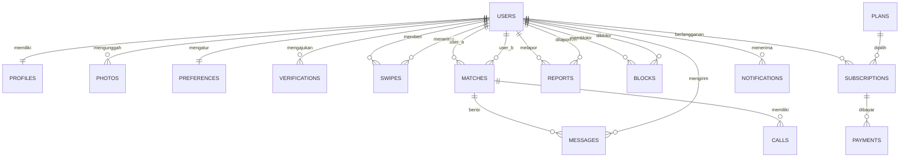

# Spesifikasi Backend Aplikasi Kencan Online

Dokumen ini adalah acuan untuk membangun backend: aktor, use case, ERD, skema SQL, daftar endpoint API, aturan bisnis, dan urutan pengerjaan.

---

## 1. Ringkasan sistem

Aplikasi kencan online tempat pengguna membuat profil, menemukan kandidat lewat swipe, saling cocok (match), lalu berkomunikasi lewat chat dan video call. Ada fitur premium berbayar, pelaporan pengguna, dan panel admin untuk moderasi.

### Aktor

| Aktor | Peran |
|---|---|
| Pengguna | Memakai fitur utama: profil, swipe, match, chat, video call, premium |
| Admin | Mengelola pengguna, memoderasi laporan, melihat statistik |
| FCM / Email | Layanan eksternal pengirim notifikasi |
| Payment gateway | Layanan eksternal pemroses pembayaran (mis. Midtrans, Xendit) |

### Use case

**Pengguna**
1. Registrasi dan login (memanggil verifikasi akun)
2. Kelola profil dan foto
3. Atur preferensi (usia, jarak, gender yang dicari)
4. Swipe kandidat (memanggil hitung kecocokan)
5. Match (memanggil kirim notifikasi)
6. Chat (memanggil kirim notifikasi)
7. Video call
8. Laporkan dan blokir pengguna
9. Beli premium (lewat payment gateway)

**Admin**
1. Kelola pengguna (suspend, aktifkan, hapus)
2. Moderasi laporan
3. Lihat statistik aplikasi

---

## 2. Saran tech stack

Ini saran, bukan keharusan. Sesuaikan dengan keahlian Anda.

| Kebutuhan | Pilihan |
|---|---|
| Bahasa / framework | Node.js (NestJS atau Express), Laravel, atau Go (Fiber/Gin) |
| Database utama | PostgreSQL (dengan ekstensi PostGIS untuk query jarak) |
| Cache dan antrean | Redis |
| Real-time chat | WebSocket (Socket.IO) |
| Video call | WebRTC (mis. LiveKit, Agora, atau Twilio) |
| Penyimpanan foto | S3 atau kompatibel (Cloudflare R2, MinIO) |
| Notifikasi | Firebase Cloud Messaging + email (SMTP/Resend) |
| Autentikasi | JWT access token + refresh token |
| Dokumentasi API | OpenAPI / Swagger |

---

## 3. ERD



### Ringkasan tabel

| Tabel | Fungsi |
|---|---|
| `users` | Akun login dan peran (user/admin) |
| `profiles` | Data diri dan lokasi |
| `photos` | Foto profil |
| `preferences` | Filter pencarian kandidat |
| `verifications` | Pengajuan verifikasi (OTP, KTP, selfie) |
| `swipes` | Aksi like/pass antar pengguna |
| `matches` | Pasangan yang saling like |
| `messages` | Pesan chat |
| `calls` | Riwayat panggilan |
| `reports` | Laporan pengguna untuk moderasi |
| `blocks` | Daftar blokir |
| `plans` | Paket premium |
| `subscriptions` | Langganan aktif pengguna |
| `payments` | Transaksi pembayaran |
| `notifications` | Riwayat notifikasi |

---

## 4. Skema SQL (PostgreSQL)

```sql
CREATE EXTENSION IF NOT EXISTS "pgcrypto";

CREATE TABLE users (
  id             UUID PRIMARY KEY DEFAULT gen_random_uuid(),
  email          VARCHAR(255) NOT NULL UNIQUE,
  phone          VARCHAR(20)  UNIQUE,
  password_hash  VARCHAR(255) NOT NULL,
  role           VARCHAR(10)  NOT NULL DEFAULT 'user'
                   CHECK (role IN ('user', 'admin')),
  status         VARCHAR(15)  NOT NULL DEFAULT 'active'
                   CHECK (status IN ('active', 'suspended', 'deleted')),
  created_at     TIMESTAMPTZ  NOT NULL DEFAULT now(),
  last_login_at  TIMESTAMPTZ
);

CREATE TABLE profiles (
  id           UUID PRIMARY KEY DEFAULT gen_random_uuid(),
  user_id      UUID NOT NULL UNIQUE REFERENCES users(id) ON DELETE CASCADE,
  full_name    VARCHAR(100) NOT NULL,
  birth_date   DATE NOT NULL,
  gender       VARCHAR(20) NOT NULL,
  bio          TEXT,
  city         VARCHAR(100),
  latitude     DOUBLE PRECISION,
  longitude    DOUBLE PRECISION,
  is_verified  BOOLEAN NOT NULL DEFAULT FALSE
);
CREATE INDEX idx_profiles_location ON profiles (latitude, longitude);

CREATE TABLE photos (
  id          UUID PRIMARY KEY DEFAULT gen_random_uuid(),
  user_id     UUID NOT NULL REFERENCES users(id) ON DELETE CASCADE,
  url         TEXT NOT NULL,
  sort_order  INT  NOT NULL DEFAULT 0,
  is_primary  BOOLEAN NOT NULL DEFAULT FALSE
);
CREATE INDEX idx_photos_user ON photos (user_id);

CREATE TABLE preferences (
  id               UUID PRIMARY KEY DEFAULT gen_random_uuid(),
  user_id          UUID NOT NULL UNIQUE REFERENCES users(id) ON DELETE CASCADE,
  interested_in    VARCHAR(20) NOT NULL,
  min_age          INT NOT NULL DEFAULT 18 CHECK (min_age >= 18),
  max_age          INT NOT NULL DEFAULT 99,
  max_distance_km  INT NOT NULL DEFAULT 50
);

CREATE TABLE verifications (
  id            UUID PRIMARY KEY DEFAULT gen_random_uuid(),
  user_id       UUID NOT NULL REFERENCES users(id) ON DELETE CASCADE,
  type          VARCHAR(20) NOT NULL CHECK (type IN ('email', 'phone', 'ktp', 'selfie')),
  document_url  TEXT,
  status        VARCHAR(15) NOT NULL DEFAULT 'pending'
                  CHECK (status IN ('pending', 'approved', 'rejected')),
  verified_at   TIMESTAMPTZ
);

CREATE TABLE swipes (
  id          UUID PRIMARY KEY DEFAULT gen_random_uuid(),
  swiper_id   UUID NOT NULL REFERENCES users(id) ON DELETE CASCADE,
  target_id   UUID NOT NULL REFERENCES users(id) ON DELETE CASCADE,
  action      VARCHAR(10) NOT NULL CHECK (action IN ('like', 'pass', 'super_like')),
  created_at  TIMESTAMPTZ NOT NULL DEFAULT now(),
  UNIQUE (swiper_id, target_id),
  CHECK (swiper_id <> target_id)
);
CREATE INDEX idx_swipes_target ON swipes (target_id, action);

CREATE TABLE matches (
  id          UUID PRIMARY KEY DEFAULT gen_random_uuid(),
  user_a_id   UUID NOT NULL REFERENCES users(id) ON DELETE CASCADE,
  user_b_id   UUID NOT NULL REFERENCES users(id) ON DELETE CASCADE,
  status      VARCHAR(15) NOT NULL DEFAULT 'active'
                CHECK (status IN ('active', 'unmatched', 'blocked')),
  matched_at  TIMESTAMPTZ NOT NULL DEFAULT now(),
  UNIQUE (user_a_id, user_b_id),
  CHECK (user_a_id < user_b_id)
);

CREATE TABLE messages (
  id         UUID PRIMARY KEY DEFAULT gen_random_uuid(),
  match_id   UUID NOT NULL REFERENCES matches(id) ON DELETE CASCADE,
  sender_id  UUID NOT NULL REFERENCES users(id) ON DELETE CASCADE,
  content    TEXT,
  media_url  TEXT,
  is_read    BOOLEAN NOT NULL DEFAULT FALSE,
  sent_at    TIMESTAMPTZ NOT NULL DEFAULT now()
);
CREATE INDEX idx_messages_match_time ON messages (match_id, sent_at);

CREATE TABLE calls (
  id            UUID PRIMARY KEY DEFAULT gen_random_uuid(),
  match_id      UUID NOT NULL REFERENCES matches(id) ON DELETE CASCADE,
  caller_id     UUID NOT NULL REFERENCES users(id) ON DELETE CASCADE,
  call_type     VARCHAR(10) NOT NULL CHECK (call_type IN ('audio', 'video')),
  status        VARCHAR(15) NOT NULL
                  CHECK (status IN ('ringing', 'answered', 'missed', 'rejected', 'ended')),
  duration_sec  INT NOT NULL DEFAULT 0,
  started_at    TIMESTAMPTZ NOT NULL DEFAULT now()
);

CREATE TABLE reports (
  id           UUID PRIMARY KEY DEFAULT gen_random_uuid(),
  reporter_id  UUID NOT NULL REFERENCES users(id) ON DELETE CASCADE,
  reported_id  UUID NOT NULL REFERENCES users(id) ON DELETE CASCADE,
  reason       VARCHAR(50) NOT NULL,
  detail       TEXT,
  status       VARCHAR(15) NOT NULL DEFAULT 'open'
                 CHECK (status IN ('open', 'reviewing', 'resolved', 'dismissed')),
  handled_by   UUID REFERENCES users(id),
  created_at   TIMESTAMPTZ NOT NULL DEFAULT now()
);
CREATE INDEX idx_reports_status ON reports (status, created_at);

CREATE TABLE blocks (
  id          UUID PRIMARY KEY DEFAULT gen_random_uuid(),
  blocker_id  UUID NOT NULL REFERENCES users(id) ON DELETE CASCADE,
  blocked_id  UUID NOT NULL REFERENCES users(id) ON DELETE CASCADE,
  created_at  TIMESTAMPTZ NOT NULL DEFAULT now(),
  UNIQUE (blocker_id, blocked_id),
  CHECK (blocker_id <> blocked_id)
);

CREATE TABLE plans (
  id             UUID PRIMARY KEY DEFAULT gen_random_uuid(),
  name           VARCHAR(50) NOT NULL,
  price          NUMERIC(12,2) NOT NULL,
  duration_days  INT NOT NULL,
  features       JSONB
);

CREATE TABLE subscriptions (
  id        UUID PRIMARY KEY DEFAULT gen_random_uuid(),
  user_id   UUID NOT NULL REFERENCES users(id) ON DELETE CASCADE,
  plan_id   UUID NOT NULL REFERENCES plans(id),
  status    VARCHAR(15) NOT NULL DEFAULT 'pending'
              CHECK (status IN ('pending', 'active', 'expired', 'cancelled')),
  start_at  TIMESTAMPTZ,
  end_at    TIMESTAMPTZ
);
CREATE INDEX idx_subscriptions_user ON subscriptions (user_id, status);

CREATE TABLE payments (
  id               UUID PRIMARY KEY DEFAULT gen_random_uuid(),
  subscription_id  UUID NOT NULL REFERENCES subscriptions(id) ON DELETE CASCADE,
  amount           NUMERIC(12,2) NOT NULL,
  method           VARCHAR(30),
  gateway_ref      VARCHAR(100) UNIQUE,
  status           VARCHAR(15) NOT NULL DEFAULT 'pending'
                     CHECK (status IN ('pending', 'paid', 'failed', 'refunded')),
  paid_at          TIMESTAMPTZ
);

CREATE TABLE notifications (
  id          UUID PRIMARY KEY DEFAULT gen_random_uuid(),
  user_id     UUID NOT NULL REFERENCES users(id) ON DELETE CASCADE,
  type        VARCHAR(30) NOT NULL,
  title       VARCHAR(150) NOT NULL,
  body        TEXT,
  is_read     BOOLEAN NOT NULL DEFAULT FALSE,
  created_at  TIMESTAMPTZ NOT NULL DEFAULT now()
);
CREATE INDEX idx_notifications_user ON notifications (user_id, is_read, created_at);
```

---

## 5. Daftar endpoint API

Prefix: `/api/v1`. Semua endpoint kecuali `auth/register`, `auth/login`, dan webhook membutuhkan header `Authorization: Bearer <token>`.

### Auth dan verifikasi

| Method | Endpoint | Deskripsi |
|---|---|---|
| POST | `/auth/register` | Daftar akun baru |
| POST | `/auth/login` | Login, mengembalikan access dan refresh token |
| POST | `/auth/refresh` | Perbarui access token |
| POST | `/auth/logout` | Cabut refresh token |
| POST | `/verifications/otp/send` | Kirim OTP ke email/telepon |
| POST | `/verifications/otp/confirm` | Konfirmasi OTP |
| POST | `/verifications/document` | Unggah KTP/selfie untuk verifikasi |

### Profil, foto, preferensi

| Method | Endpoint | Deskripsi |
|---|---|---|
| GET | `/me` | Data akun dan profil sendiri |
| PUT | `/me/profile` | Ubah profil |
| PUT | `/me/location` | Perbarui lokasi |
| POST | `/me/photos` | Unggah foto |
| PATCH | `/me/photos/:id` | Ubah urutan / jadikan foto utama |
| DELETE | `/me/photos/:id` | Hapus foto |
| GET | `/me/preferences` | Lihat preferensi |
| PUT | `/me/preferences` | Ubah preferensi |

### Swipe dan match

| Method | Endpoint | Deskripsi |
|---|---|---|
| GET | `/discover?limit=20` | Daftar kandidat sesuai preferensi |
| POST | `/swipes` | Body: `{ target_id, action }`. Jika saling like, buat match |
| GET | `/matches` | Daftar match aktif |
| DELETE | `/matches/:id` | Unmatch |

### Chat dan call

| Method | Endpoint | Deskripsi |
|---|---|---|
| GET | `/matches/:id/messages?before=<ts>&limit=30` | Riwayat pesan (paginasi) |
| POST | `/matches/:id/messages` | Kirim pesan |
| PATCH | `/matches/:id/messages/read` | Tandai terbaca |
| POST | `/matches/:id/calls` | Mulai panggilan, mengembalikan token WebRTC |
| PATCH | `/calls/:id` | Ubah status (jawab, tolak, akhiri) |
| GET | `/matches/:id/calls` | Riwayat panggilan |

WebSocket (`/ws`), event yang disarankan:

| Event | Arah | Isi |
|---|---|---|
| `message:new` | server → klien | Pesan baru |
| `message:read` | server → klien | Pesan dibaca lawan bicara |
| `typing` | dua arah | Indikator mengetik |
| `match:new` | server → klien | Match baru |
| `call:incoming` | server → klien | Panggilan masuk |

### Laporan dan blokir

| Method | Endpoint | Deskripsi |
|---|---|---|
| POST | `/reports` | Laporkan pengguna |
| POST | `/blocks` | Blokir pengguna |
| GET | `/blocks` | Daftar blokir |
| DELETE | `/blocks/:user_id` | Buka blokir |

### Premium dan pembayaran

| Method | Endpoint | Deskripsi |
|---|---|---|
| GET | `/plans` | Daftar paket |
| POST | `/subscriptions` | Body: `{ plan_id }`. Buat langganan `pending` dan transaksi di gateway |
| GET | `/subscriptions/me` | Status langganan aktif |
| POST | `/webhooks/payment` | Webhook dari gateway (verifikasi signature, tanpa JWT) |

### Notifikasi

| Method | Endpoint | Deskripsi |
|---|---|---|
| GET | `/notifications` | Daftar notifikasi |
| PATCH | `/notifications/:id/read` | Tandai terbaca |
| POST | `/me/devices` | Daftarkan token FCM perangkat |

### Admin (`role = admin`)

| Method | Endpoint | Deskripsi |
|---|---|---|
| GET | `/admin/users` | Cari dan filter pengguna |
| PATCH | `/admin/users/:id/status` | Suspend, aktifkan, atau hapus |
| GET | `/admin/reports?status=open` | Antrean laporan |
| PATCH | `/admin/reports/:id` | Ubah status dan catat `handled_by` |
| GET | `/admin/verifications?status=pending` | Antrean verifikasi dokumen |
| PATCH | `/admin/verifications/:id` | Setujui atau tolak |
| GET | `/admin/stats` | Statistik: pengguna, match, pesan, pendapatan |

---

## 6. Aturan bisnis

1. **Usia minimal 18 tahun.** Tolak registrasi jika `birth_date` kurang dari 18 tahun.
2. **Match terjadi otomatis** saat A like B dan B sudah pernah like A. Simpan pasangan dengan `user_a_id < user_b_id`.
3. **Satu swipe per pasangan.** Pasangan `(swiper_id, target_id)` unik.
4. **Chat dan call hanya untuk match berstatus `active`.**
5. **Blokir berlaku dua arah:** pengguna yang memblokir dan yang diblokir saling hilang dari `/discover`, dan match di antara mereka diubah menjadi `blocked`.
6. **Pengguna `suspended` tidak bisa login** dan tidak muncul di `/discover`.
7. **Kandidat yang sudah di-swipe tidak muncul lagi** di `/discover`.
8. **Filter kandidat** memakai `preferences`: gender, rentang usia, dan jarak (rumus Haversine atau PostGIS).
9. **Batas fitur gratis** (contoh, bisa diubah): maksimal 50 like per hari. Premium tanpa batas.
10. **Langganan menjadi `active` hanya setelah webhook pembayaran berstatus `paid`.** Jangan percaya status dari klien.
11. **Webhook harus idempoten.** Cek `gateway_ref` agar notifikasi ganda dari gateway tidak mengaktifkan langganan dua kali.
12. **Langganan kedaluwarsa** lewat job terjadwal yang mengubah status menjadi `expired` saat `end_at` terlewati.
13. **Notifikasi** dikirim saat: match baru, pesan baru (jika lawan bicara offline), panggilan masuk, hasil verifikasi, dan status langganan berubah.

---

## 7. Struktur folder yang disarankan (contoh NestJS)

```
src/
├── main.ts
├── config/              # env, database, redis, fcm
├── common/              # guard, decorator, filter, pipe
├── modules/
│   ├── auth/
│   ├── users/
│   ├── profiles/
│   ├── photos/
│   ├── preferences/
│   ├── verifications/
│   ├── discover/
│   ├── swipes/
│   ├── matches/
│   ├── chat/            # REST + WebSocket gateway
│   ├── calls/
│   ├── reports/
│   ├── blocks/
│   ├── plans/
│   ├── subscriptions/
│   ├── payments/        # termasuk webhook
│   ├── notifications/
│   └── admin/
├── jobs/                # cron: expire langganan, bersihkan token
└── database/
    ├── migrations/
    └── seeds/
```

---

## 8. Urutan pengerjaan

1. **Fondasi:** setup proyek, koneksi database, migrasi skema, autentikasi JWT, role guard.
2. **Profil:** profil, foto (upload ke S3), preferensi, verifikasi OTP.
3. **Inti produk:** endpoint `/discover`, swipe, logika match.
4. **Komunikasi:** chat REST + WebSocket, status terbaca, lalu integrasi video call.
5. **Keamanan:** laporan, blokir, dan panel moderasi admin.
6. **Monetisasi:** paket, langganan, integrasi payment gateway, webhook, job kedaluwarsa.
7. **Notifikasi:** FCM, email, dan riwayat notifikasi.
8. **Finalisasi:** statistik admin, rate limiting, logging, pengujian, dokumentasi Swagger, deployment.

---

## 9. Catatan keamanan dan kinerja

- Hash password dengan bcrypt atau argon2. Jangan simpan password polos.
- Terapkan rate limiting pada login, OTP, dan swipe.
- Validasi semua input (panjang, format, tipe file foto, ukuran maksimal).
- Simpan foto dan dokumen KTP di bucket privat dengan signed URL. Dokumen KTP jangan publik.
- Lakukan pengecekan otorisasi pada tiap endpoint: pengguna hanya boleh mengakses match dan pesan miliknya.
- Cache hasil `/discover` dan data lokasi di Redis agar query tidak berat.
- Gunakan paginasi berbasis kursor (`before=<timestamp>`) untuk riwayat chat.
- Patuhi regulasi perlindungan data pribadi (UU PDP) karena aplikasi menyimpan data sensitif seperti lokasi, foto, dan dokumen identitas.
